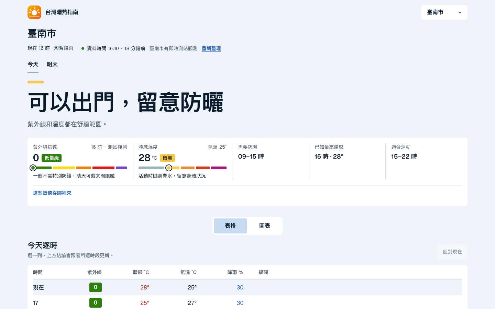
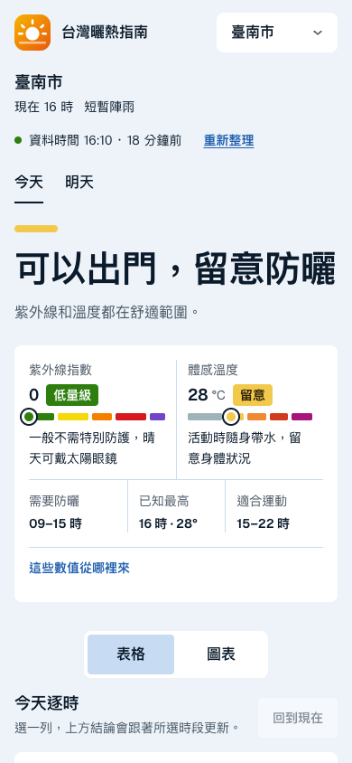

# 台灣曬熱指南

現在適合出門嗎？這個網站用中央氣象署開放資料，回答你所在縣市「現在」和「明天」的紫外線與高溫狀況：要不要防曬、最熱是幾點、什麼時候適合運動、出門該帶什麼。給需要在出門前快速判斷戶外風險的一般民眾、照顧者、運動者與戶外工作者。

線上版：https://livejiaquan.github.io/taiwan-uv-heat-dashboard/

<p>
  
  
</p>

## 功能

- **一句話結論**：依所選縣市與時段給出建議，結論色帶依較嚴重的指標著色。
- **指標列**：紫外線（WHO 五級）與體感溫度，以色階條上的圓點標出位置，並附該等級的具體行動。
- **逐時表格與圖表**：逐時的紫外線、體感、氣溫與降雨機率；選一列即更新上方結論。
- **今天／明天切換**，可提前規劃隔天行程。
- **曬傷時間估算**：依膚質估算未擦防曬時多久會曬紅。
- **出門清單與 LINE 提醒**：依當天資料列出要帶的東西，並產生可直接貼到群組的文字。
- **分對象建議**：一般外出、兒童與長者、運動、戶外工作。
- **全台比較**：縣市著色地圖（含金門、連江小框）與可排序清單。
- **高溫提醒**：預報最高氣溫達氣象署高溫資訊門檻（36°C／38°C）時提示。
- **資料時效**：結論上方顯示資料時間與年齡；資料舊了仍照常顯示並標示。
- 手機優先、深淺色、鍵盤操作與螢幕閱讀器支援。

## 資料

使用中央氣象署官方公開氣象檔案，預設免註冊與私人金鑰；也支援 API 金鑰模式，詳見 [`docs/DATA_SOURCES.md`](docs/DATA_SOURCES.md)。GitHub Actions 定時取得資料並發布快照，瀏覽器只讀同站 JSON。缺資料時明示無法評估，示範資料必須以 `?demo=1` 主動進入。排程為最佳努力更新，本站不是即時警報服務；天氣警特報與高溫資訊燈號請以中央氣象署為準。

資料與地圖來源的授權與標示見 [THIRD_PARTY_NOTICES.md](THIRD_PARTY_NOTICES.md)。

## 本機執行

需要 Node.js 22.14 以上。

```bash
npm ci
npm run collect:weather   # 取得官方公開資料，產生 public/data/weather.json
npm run dev               # 開啟 http://localhost:5173/taiwan-uv-heat-dashboard/
```

```bash
npm run lint
npm run typecheck
npm test
npm run build:public      # 建置並掃描產物
```

若有氣象署 API 金鑰，可複製 `.env.example` 為 `.env.local` 並填入 `CWA_API_KEY`（僅供本機收集使用）。

## 專案結構

```
src/lib/            資料解析、快照驗證、體感與等級計算、建議文字、資料時效
src/features/dashboard/   頁面與元件
src/data/           縣市資料、地圖、示範資料
scripts/            資料收集與建置腳本
public/             品牌標記、favicon、授權聲明
docs/               架構、資料來源、部署與設計筆記
```

進一步閱讀：[架構](docs/ARCHITECTURE.md)、[資料來源](docs/DATA_SOURCES.md)、[部署](docs/DEPLOYMENT.md)、[設計筆記](docs/design.md)、[使用者與情境](docs/users.md)。

貢獻方式見 [CONTRIBUTING.md](CONTRIBUTING.md)，安全回報見 [SECURITY.md](SECURITY.md)。

## 授權

程式碼採 [MIT License](LICENSE)。
