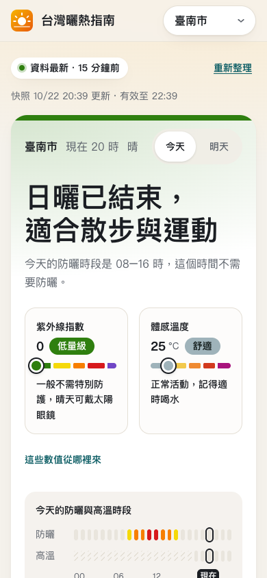

# 台灣曬熱指南

現在適合出門嗎？這個網站用中央氣象署開放資料，直接回答你所在縣市「現在」和「明天」的紫外線與高溫狀況：防曬時段、最熱時刻、適合運動的時間、出門該帶什麼，並可一鍵複製提醒傳到 LINE。

線上版：https://livejiaquan.github.io/taiwan-uv-heat-dashboard/



## 功能

- **一句話結論**：依所選縣市與時段給出建議；結論卡依當下較嚴重的指標著色。
- **全天時段條**：一眼看出哪些時段需要防曬、哪些時段體感 32° 以上，缺資料的時段以斜線標示。
- **指標卡**：紫外線與體感溫度以色階條加圓點標出位置，並附該等級的具體行動。
- **今天／明天切換**：可提前規劃隔天行程。
- **逐時時間軸**：體感溫度曲線、逐時紫外線、降雨機率；手機上左右滑動，點一下選時段。
- **曬傷時間估算**：依膚質估算未擦防曬時多久會曬紅。
- **出門清單與 LINE 提醒**：依當天資料列出要帶的東西，並產生可直接貼到群組的文字。
- **分對象建議**：一般外出、兒童與長者、運動、戶外工作。
- **全台比較**：縣市著色地圖（含金門、連江小框）與可排序清單。
- **高溫提醒**：預報最高氣溫達氣象署高溫資訊門檻（36°C／38°C）時提示。
- **資料時效**：顯示快照時間、有效期限與「最新／延遲」狀態。
- 手機優先的版面、深色模式、鍵盤操作與螢幕閱讀器支援。設計依據見 [`docs/design-research.md`](docs/design-research.md)，使用者與裝置分析見 [`docs/ux-research.md`](docs/ux-research.md)。

## 資料

使用中央氣象署官方公開氣象檔案，預設免註冊與私人金鑰；也支援 Actions Secret 的 API 模式，詳見 [`docs/DATA_SOURCES.md`](docs/DATA_SOURCES.md)。GitHub Actions 定時取得並發布資料快照，瀏覽器只讀同站 JSON。缺資料時明示無法評估；資料時間顯示在結論上方，依資料本身的時間標示「即時（90 分鐘內）／稍舊（6 小時內）／過舊（24 小時內，附官方連結）」，更舊的資料仍照常顯示並註明時間；示範資料必須以 `?demo=1` 主動進入。排程為最佳努力更新，本站不是即時警報服務。

## 開發

```bash
npm ci
cp .env.example .env.local   # 可選：填入 CWA_API_KEY，僅供本機收集
npm run collect:weather
npm run dev
```

```bash
npm run lint
npm run typecheck
npm test
npm run build:public
```

Node.js 22.14 以上。啟用 GitHub Actions 與 Pages 即可收集官方公開檔案；`CWA_API_KEY` Secret 為選用的 API 模式，詳見部署文件。

- 架構：[`docs/ARCHITECTURE.md`](docs/ARCHITECTURE.md)
- 部署：[`docs/DEPLOYMENT.md`](docs/DEPLOYMENT.md)

## 說明

本站不是官方服務，內容僅供參考；天氣警特報與高溫資訊燈號請以中央氣象署發布為準。體感溫度的五個分級是本站自訂的參考門檻，不是官方分級。

貢獻方式見 [CONTRIBUTING.md](CONTRIBUTING.md)，安全回報見 [SECURITY.md](SECURITY.md)。

程式碼採 [MIT License](LICENSE)。氣象資料與地圖來源的授權及標示另見 [THIRD_PARTY_NOTICES.md](THIRD_PARTY_NOTICES.md)。
